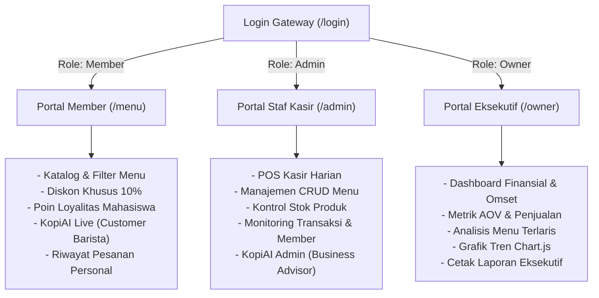
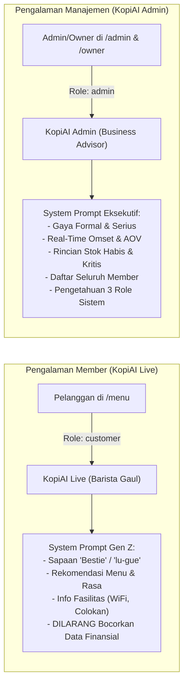

# PRODUCT REQUIREMENT DOCUMENT (PRD)
# SISTEM KOPI MAHASISWA

**Nama Produk:** Kopi Mahasiswa Web & POS Ecosystem  
**Versi:** 2.0 (Multi-Role & AI-Powered)  
**Lingkungan Operasional:** Laragon / Apache Web Server (Windows)  
**Dokumen Status:** Approved / Production-Ready  
**Bahasa Dokumen:** Bahasa Indonesia  

---

## 1. RINGKASAN PRODUK (PRODUCT OVERVIEW)

### 1.1 Latar Belakang
**Kopi Mahasiswa** adalah ekosistem digital berbasis web terintegrasi yang dirancang khusus untuk memenuhi kebutuhan operasional kedai kopi modern dengan target pasar utama mahasiswa dan civitas akademika. Sistem ini menjembatani interaksi antara pelanggan mahasiswa, staf operasional kasir (Admin), dan pemilik kedai (Owner) dalam satu kesatuan sistem yang cepat, ringan, responsif, dan cerdas.

### 1.2 Tujuan Produk
1. **Mempermudah Pemesanan Pelanggan (Member):** Memberikan kemudahan bagi mahasiswa untuk melihat katalog menu real-time, memesan secara online/dine-in/takeaway, mendapatkan diskon loyalitas 10%, mengumpulkan poin, serta berinteraksi dengan asisten virtual ramah Gen Z (KopiAI Live).
2. **Optimalisasi Operasional Harian (Admin):** Menyediakan portal kasir (Point of Sale - POS) untuk mencatat pesanan, mengelola stok bahan/menu secara akurat, serta memantau status pesanan dan data member.
3. **Visibilitas Finansial & Bisnis Real-Time (Owner):** Memberikan akses analitik eksekutif mengenai omset, rata-rata transaksi (AOV), menu terlaris (*best seller*) vs menu sepi (*slow mover*), dan tren pendapatan harian/mingguan/bulanan.
4. **Penerapan Kecerdasan Buatan (Dual AI Persona):** Menghadirkan asisten AI cerdas dengan persona terpisah: KopiAI Live (gaul & ramah untuk pelanggan) dan KopiAI Admin (formal & analitis untuk manajemen bisnis).

---

## 2. STRUKTUR 3 TINGKAT PERAN (USER ROLES & PERMISSIONS)

Sistem Kopi Mahasiswa menerapkan pembagian peran yang tegas (*Strict Role-Based Access Control*) dengan 3 tingkatan hak akses:



### 2.1 Role 1: Member (Pelanggan / Mahasiswa)
* **Kategori Pengguna:** Pelanggan umum, mahasiswa, dan komunitas kampus.
* **Halaman Utama:** `/menu` (`menu.php` -> `menu.html`) & Landing Page `/` (`index.php` -> `index.html`).
* **Metode Masuk:** Nomor WhatsApp terdaftar + Kata Sandi (default: `123456` untuk migrasi lama).
* **Fitur & Hak Akses:**
  * Eksplorasi katalog menu dengan filter kategori (*Coffee, Non-Coffee, Snack/Makanan, Signature*).
  * Diskon otomatis member sebesar **10%** yang langsung dipotong pada keranjang belanja.
  * Sistem poin loyalitas mahasiswa (bonus 100 poin saat registrasi baru).
  * Pemesanan interaktif: Pilihan opsi *Dine-in* (dengan nomor meja) atau *Takeaway*.
  * Integrasi pembayaran fleksibel (QRIS dinamis dan Tunai di Kasir).
  * Riwayat belanja personal berbasis nomor HP/nama member.
  * Bantuan konsultasi barista virtual ramah **KopiAI Live**.
  * Menerima notifikasi otomatis WhatsApp saat registrasi akun baru berhasil.

### 2.2 Role 2: Admin (Staf Kasir & Operasional Kafe)
* **Kategori Pengguna:** Kasir, barista jaga, staf gudang/operasional kedai.
* **Halaman Utama:** `/admin` (`admin.php` -> `admin.html`).
* **Kredensial Autentikasi:** Username: `admin` | Kata Sandi: `admin12345` (atau `admin123`).
* **Fitur & Hak Akses:**
  * Point of Sale (POS) kasir harian: menerima dan memvalidasi pesanan pelanggan.
  * Manajemen Katalog Produk (CRUD): Tambah menu baru, ubah harga, ganti deskripsi, upload/edit tautan gambar produk.
  * Kontrol Stok Real-Time: Status stok aman, status stok kritis (1-3 porsi), dan status stok habis (0 / sold out).
  * Manajemen Data Pelanggan: Melihat seluruh member terdaftar dari berkas `members.json`.
  * Pemantauan Pesanan Aktif: Polling pesanan masuk dan verifikasi pembayaran.
  * Akses ke **KopiAI Admin** untuk konsultasi cepat operasional dan stok produk.

### 2.3 Role 3: Owner (Pemilik Usaha / Manajemen Eksekutif)
* **Kategori Pengguna:** Pemilik kafe (*business owner*), investor, atau direktur usaha.
* **Halaman Utama:** `/owner` (`owner.php` -> `owner.html`).
* **Kredensial Autentikasi:** Username: `owner` | Kata Sandi: `owner123` / PIN `1234` / `owner2026`.
* **Fitur & Hak Akses:**
  * Dashboard Analitik Finansial Real-Time (Omset Bruto, Total Pesanan Selesai, Average Order Value).
  * Visualisasi Tren Pendapatan Interaktif (Grafik harian, mingguan, dan bulanan menggunakan Chart.js).
  * Evaluasi Performa Menu: Tabel Top 5 Menu Paling Laris (*Best Seller*) dan 5 Menu Sepi Penjualan (*Slow Mover*).
  * Audit Riwayat Transaksi Finansial Lengkap (Kode Transaksi, Nama Pelanggan, Jam Transaksi, Rincian Item, Total Bayar, Metode Pembayaran).
  * Fitur Ekspor & Cetak Laporan Keuangan Eksekutif (*Print-friendly view*).
  * Akses konsultasi strategi bisnis tingkat tinggi dengan **KopiAI Admin**.

---

## 3. ARSITEKTUR & STACK TEKNOLOGI

Sistem dibangun menggunakan pendekatan arsitektur *lightweight hybrid* yang menggabungkan kecepatan pemrosesan PHP Native untuk penanganan HTTP/rendering halaman, penyimpanan ganda (MySQL + JSON), dan layanan microservice Node.js untuk bot WhatsApp serta AI gateway.

| Layer / Komponen | Teknologi yang Digunakan | Penjelasan & Alasan Pemilihan |
| :--- | :--- | :--- |
| **Web Server** | Apache (Laragon Suite) | Server HTTP standar dengan dukungan `mod_rewrite`, `mod_proxy`, dan proteksi modular. |
| **Routing & URL** | Apache `.htaccess` | Menyajikan Clean URL tanpa ekstensi file (`/login`, `/admin`, `/owner`, `/menu`) dan mencegah *directory listing*. |
| **Backend Core** | PHP Native 8.x | Arsitektur tanpa framework (*zero heavy dependency*) yang cepat, efisien memori, dan mudah dipelihara. |
| **Database Utama** | MySQL (InnoDB, utf8mb4_unicode_ci) | Menyimpan data terstruktur: tabel `menu`, `pesanan`, dan `pesanan_detail`. Menggunakan PDO Prepared Statements. |
| **Flat File Database** | JSON (`members.json`) | Menyimpan data pendaftaran member, riwayat poin, dan status pelanggan secara cepat tanpa migrasi skema tabel yang rumit. |
| **Session & Auth** | PHP Native Session + HTTP Cookies | Sesi aman berbasis server (`$_SESSION['role']`) dengan fallback *HTTP cookies* dan sinkronisasi `localStorage` browser. |
| **Microservice Bot & AI**| Node.js (Express v4.21+) | Menjalankan *background worker* (`index.js`) untuk bot WhatsApp (`whatsapp-web.js`) dan API router AI. |
| **LLM Gateway** | OpenRouter API / LLM Providers | Model kecerdasan buatan multi-model (OpenAI GPT / DeepSeek / Google Gemini) untuk *chat engine*. |
| **Frontend UI** | HTML5 Semantik, Tailwind CSS, Custom CSS | Desain responsif bertema Dark Coffee modern, tipografi Google Inter & Poppins, serta antarmuka ramah perangkat bergerak (*mobile-friendly*). |
| **Visualisasi Data** | Chart.js | Rendering grafik batang (*bar*) dan garis (*line*) untuk visualisasi tren omset di panel Owner. |

---

## 4. SPESIFIKASI FITUR UTAMA & DUAL AI SYSTEM

### 4.1 Toko & Katalog Pemesanan Member (`/menu`)
1. **Navigasi Tab Kategori:** Memfilter menu instan berdasarkan *Semua, Coffee, Non-Coffee, Makanan/Snack, Signature*.
2. **Smart Cart System:**
   - Tambah/kurang kuantitas item pesanan.
   - Perhitungan diskon otomatis 10% jika terdeteksi login sebagai member.
   - Pilihan tipe pesanan: *Dine-in* (Wajib memasukkan Nomor Meja) atau *Takeaway*.
3. **Modal Checkout Terintegrasi:**
   - Menghasilkan kode transaksi unik (contoh: `KM-174123456789`).
   - Pilihan metode bayar: QRIS Dinamis (menampilkan simulasi QR Code) atau Tunai di Kasir.
   - Pencatatan otomatis ke MySQL melalui endpoint `owner_analytics.php`.

### 4.2 Portal Kasir & POS Operasional Admin (`/admin`)
1. **Katalog Produk CRUD Real-Time:**
   - Form penambahan menu baru (Nama, Kategori, Harga, Stok Awal, Deskripsi, URL Gambar).
   - Fitur edit langsung di tabel kasir serta tombol hapus produk.
2. **Manajemen Stok Cerdas:**
   - Indikator warna badge stok: Hijau (Stok > 3), Kuning (Stok 1-3 / Kritis), Merah (Stok 0 / Habis).
   - Tombol cepat tambah/kurang kuantitas stok tanpa membuka dialog edit.
3. **Data Member Terpusat:**
   - Menampilkan daftar nama, asal kampus, nomor WhatsApp, dan jumlah poin seluruh member terdaftar.

### 4.3 Dashboard Eksekutif & Finansial Owner (`/owner`)
1. **Kartu Indikator Utama (KPI Cards):**
   - **Total Omset:** Akumulasi pendapatan kotor (*gross revenue*) dari seluruh pesanan berstatus sukses.
   - **Total Pesanan:** Jumlah transaksi yang berhasil diselesaikan.
   - **AOV (Average Order Value):** Rata-rata nilai transaksi per pelanggan (Total Omset / Total Pesanan).
   - **Total Pelanggan:** Jumlah member terdaftar yang tercatat aktif.
2. **Grafik Tren Pendapatan Dinamis:**
   - Pilihan filter waktu: Harian (7 hari terakhir), Mingguan (4 minggu terakhir), dan Bulanan (12 bulan).
3. **Tabel Top 5 Best Sellers & 5 Slow Movers:**
   - Evaluasi produk yang paling banyak menyumbang pendapatan vs produk yang memerlukan promo dorongan.
4. **Cetak Laporan Keuangan:** Tombol cetak langsung ke format dokumen fisik/PDF dengan tata letak laporan rahasia eksekutif.

### 4.4 Sistem Kecerdasan Buatan Ganda (Dual AI Persona)

Sistem Kopi Mahasiswa mengimplementasikan isolasi persona yang tegas pada endpoint AI (`/api/ai-chat` pada Node.js):



#### A. KopiAI Live (Barista & Customer Service Virtual)
* **Target Pengguna:** Pengunjung kafe & Member pelanggan di halaman `/menu`.
* **Persona & Nada Bicara:** Gaul, asik, ramah, santai khas Gen Z (menggunakan sapaan *"lu-gue"*, *"Bestie"*, *"chill"*, *"spill"*, *"gaskeun"*).
* **Cakupan Pengetahuan:**
  * Penjelasan cita rasa menu kopi dan non-kopi.
  * Rekomendasi minuman berdasarkan suasana hati (*mood booster*, teman nugas, pelepas kantuk).
  * Informasi fasilitas kafe: WiFi kencang, stopkontak di setiap meja, jam operasional (08.00 - 23.00 WIB), alamat Jl. Kampus Merdeka No. 45.
  * Personalisasi nama pelanggan dan poin loyalitas jika member sedang login.
* **Batasan Keamanan (Guardrail):** Sama sekali **tidak memiliki akses** ke data omset, margin keuntungan, rincian database internal, atau data privasi member lain.

#### B. KopiAI Admin (Konsultan Bisnis & Operasional Eksekutif)
* **Target Pengguna:** Staf Kasir (Admin) di `/admin` dan Pemilik Kafe (Owner) di `/owner`.
* **Persona & Nada Bicara:** Formal, profesional, singkat, padat, analitis, *to-the-point* tanpa bahasa santai atau slang Gen Z.
* **Cakupan Pengetahuan:**
  * **Struktur Peran Sistem:** Memahami secara mendalam 3 tingkatan peran (Member, Admin, Owner) beserta rincian hak aksesnya.
  * **Finansial Real-Time:** Mengetahui total omset aktif, total transaksi, dan AOV langsung dari MySQL.
  * **Inventaris & Stok:** Menyajikan daftar produk yang stoknya habis (*Out of Stock*) dan stok kritis (<= 3).
  * **Data Member:** Mengetahui jumlah total dan daftar seluruh member yang terdaftar di `members.json`.
  * **Top Seller & Transaksi Terbaru:** Mengetahui 5 menu terlaris dan rincian transaksi kasir terkini.

---

## 5. KEAMANAN & ASPEK NON-FUNGSIONAL

### 5.1 Proteksi File Sensitif (.htaccess)
File konfigurasi Apache `.htaccess` mengunci akses langsung dari browser (HTTP 403 Forbidden) terhadap berkas-berkas penting:
* Berkas konfigurasi rahasia: `.env`
* Basis data flat-file: `members.json` dan `admins.json`
* Berkas dependensi & log: `package.json`, `package-lock.json`, `bot_debug.log`, `.gitignore`

### 5.2 Anti-Directory Listing
Direktif `Options -Indexes` diaktifkan secara global di root project untuk mencegah pihak luar melihat daftar file di folder publik.

### 5.3 Route Guard & Pemisahan Sesi (Role Guarding)
* Setiap gerbang halaman PHP (`admin.php`, `owner.php`, `menu.php`) memvalidasi sesi aktif pengguna (`$_SESSION['role']`).
* Jika pengguna dengan peran `member` mencoba membuka `/admin` atau `/owner`, server langsung menolak dan mengalihkan ke `/login?role=admin` atau `/menu`.
* Sinkronisasi otomatis antara `$_SESSION` server, `Set-Cookie`, dan `localStorage` browser untuk mencegah ketidaksinkronan status (*stale state*).

### 5.4 Pencegahan SQL Injection & Sanitasi Data
* Seluruh interaksi database di `owner_analytics.php`, `get_menu.php`, dan `update_menu.php` menggunakan **PDO Prepared Statements** dengan *parameterized binding*.
* Normalisasi nomor telepon otomatis ke standar internasional Indonesia (`628xxx`) untuk konsistensi pencarian member dan pengiriman notifikasi WhatsApp.

### 5.5 Proteksi Header HTTP
* `X-Frame-Options: SAMEORIGIN` terpasang di seluruh endpoint untuk mencegah serangan *Clickjacking*.
* `X-Content-Type-Options: nosniff` mencegah eksekusi *MIME-type sniffing*.

---

## 6. KRITERIA KEBERHASILAN SISTEM (SUCCESS & ACCEPTANCE CRITERIA)

| Area Fungsional | Kriteria Keberhasilan (Acceptance Criteria) | Status Pengujian |
| :--- | :--- | :--- |
| **URL Bersih (.htaccess)** | URL `/login`, `/admin`, `/owner`, `/menu` dapat diakses langsung tanpa ekstensi `.php`/`.html` dan tidak menimbulkan error 404 pada Laragon. | **TERVERIFIKASI** |
| **Proteksi File Rahasia** | Percobaan akses browser langsung ke `http://localhost/members.json` atau `.env` menghasilkan status **403 Forbidden**. | **TERVERIFIKASI** |
| **Form Login Independen** | Halaman `/login` memiliki form HTML terpisah untuk masing-masing tab (Member Masuk, Member Daftar, Admin, Owner) sehingga submit tombol tidak pernah macet (*stuck*) akibat validasi input `required` tersembunyi. | **TERVERIFIKASI** |
| **Autentikasi Multi-Role** | Kredensial Admin (`admin` / `admin12345`) berhasil membawa ke `/admin`. Kredensial Owner (`owner` / `owner123` / PIN `1234`) berhasil membawa ke `/owner`. Member terdaftar berhasil membawa ke `/menu`. | **TERVERIFIKASI** |
| **Isolasi Halaman Role** | Member yang belum login tidak dapat membuka `/admin` atau `/owner`. Begitu pula pengguna yang belum login diarahkan secara otomatis ke `/login`. | **TERVERIFIKASI** |
| **Kalkulasi Diskon Member** | Keranjang belanja member secara otomatis memotong diskon 10% dari total belanja kotor dan mencatat total bersih ke database MySQL. | **TERVERIFIKASI** |
| **Dual AI Persona Separation** | KopiAI Live di `/menu` berbicara ramah/santai Gen Z tanpa membocorkan data omset. KopiAI Admin di `/admin` & `/owner` menjawab formal, tegas, dan menyajikan metrik omset, stok kritis, dan struktur 3 role secara presisi. | **TERVERIFIKASI** |
| **Stabilitas & Persistensi Data** | Data transaksi baru yang di-checkout dari `/menu` langsung menambah total omset dan tercatat di tabel `pesanan` serta `pesanan_detail` MySQL tanpa jeda. | **TERVERIFIKASI** |

---

## 7. STRUKTUR BERKAS PROJECT (FILE DIRECTORY STRUCTURE)

```
c:\laragon\www\kopi\
├── .env                     # File konfigurasi rahasia (API Keys, DB Credentials) [Protected 403]
├── .htaccess                # Konfigurasi Apache: Rewrite Rules, Clean URL, Proteksi File
├── admin.html               # Tampilan antarmuka Dashboard Kasir & Admin POS
├── admin.php                # Gateway & Session Guard untuk Role Admin
├── bot-proxy.php            # Proxy handler PHP untuk komunikasi dengan Node.js service
├── bot_debug.log            # Log debugging service WhatsApp Bot
├── get_menu.php             # REST API untuk mengambil data menu dari MySQL (JSON)
├── index.html               # Landing page pembuka etalase Kopi Mahasiswa
├── index.js                 # Express Microservice, WhatsApp Web Bot, & AI Chat Gateway
├── index.php                # Entrypoint utama web Kopi Mahasiswa
├── login.php                # Multi-Role Authentication Controller & Form Gateway
├── members.json             # Flat-file database akun pelanggan/member [Protected 403]
├── menu.html                # Tampilan katalog menu & keranjang belanja Member
├── menu.php                 # Gateway & Session Guard untuk Role Member
├── owner.html               # Tampilan antarmuka Dashboard Eksekutif Owner
├── owner.php                # Gateway & Session Guard untuk Role Owner
├── owner_analytics.php      # REST API perhitungan finansial, omset, & checkout MySQL
├── package.json             # Dependensi Node.js (express, whatsapp-web.js, mysql2, cors)
├── PRD_KOPI_MAHASISWA.md    # Product Requirement Document (Dokumen ini)
├── update_menu.php          # REST API untuk mutasi & pembaruan stok/menu MySQL
├── css/                     # Berkas styling tampilan antarmuka
├── images/                  # Aset grafis produk & media kafe
└── js/                      # Modul JavaScript klien (ai-engine.js, ai-barista.js, dll.)
```

---

*Dokumen PRD ini disusun sebagai acuan standar fungsional, arsitektural, dan spesifikasi teknis ekosistem Kopi Mahasiswa.*

